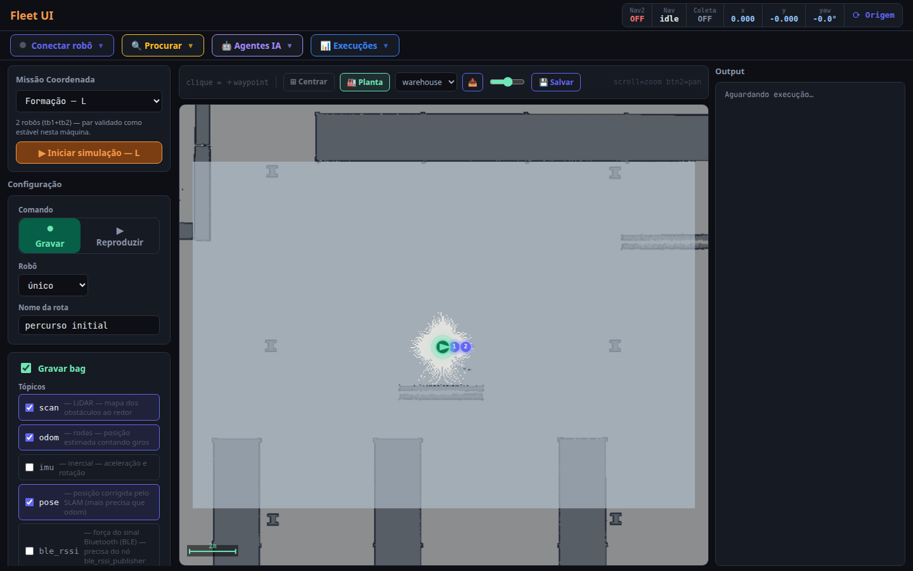
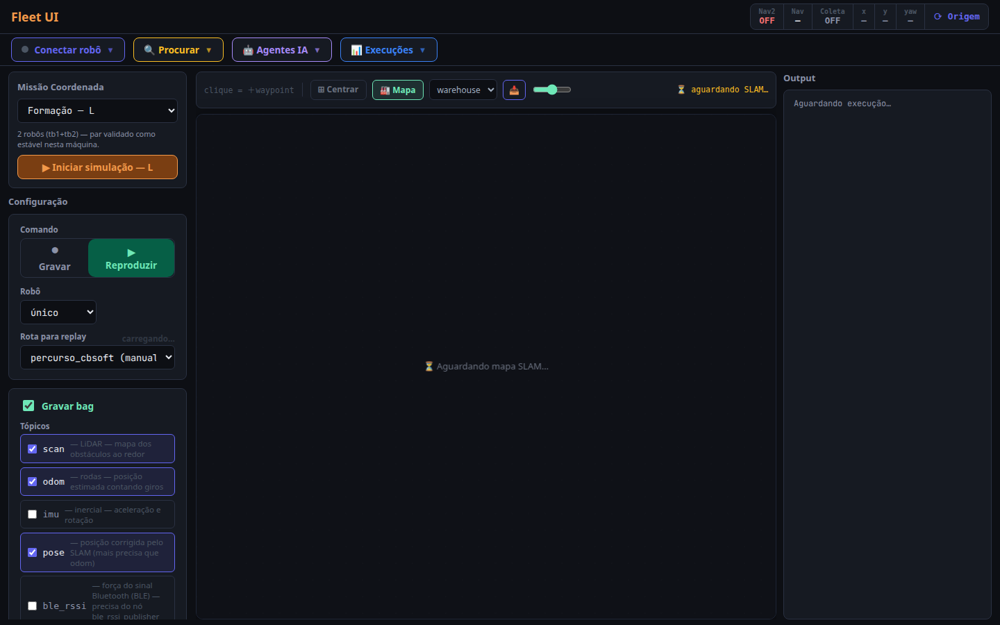
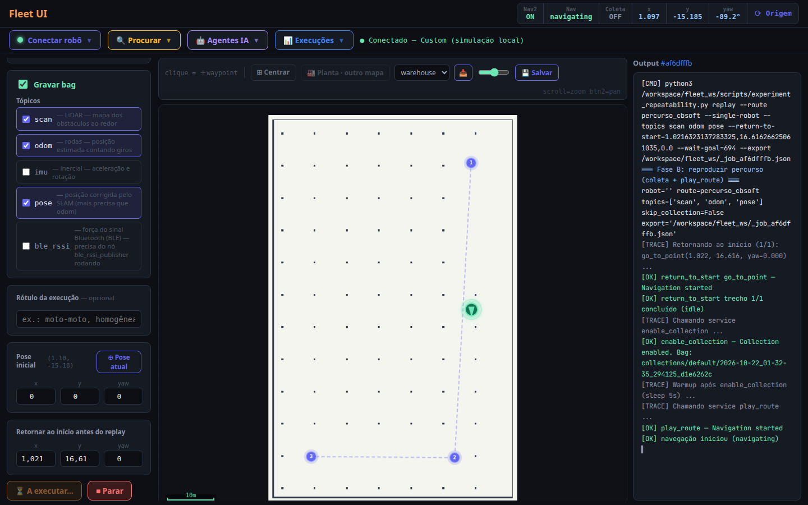
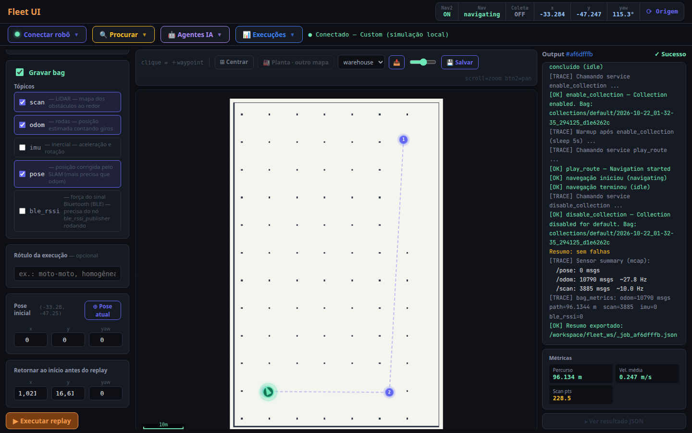

# Fleet UI

[](https://github.com/eduardowanderleyde/fleet-ui/actions/workflows/ci.yml)
[](LICENSE)

**Fleet UI tests whether a mobile robot repeats the same route the same way,
every time.** Click points on a map to record a route once, replay it as many
times as you want, and see exactly how much the robot's path varied between
runs — distance, speed, duration, how closely it matched the original. It all
happens on a web page; you never have to type a robot command by hand.

> **Use the `new-way-samsung` branch**, not `main` — it's the one with
> `setup.sh`/`run_all.sh`, the CBSoft open-world route and the features this
> README describes. Every `git clone` command below already includes
> `-b new-way-samsung`.

> An experimental **AI agent layer** (natural-language control via
> Claude/Anthropic, `backend/agents/`) also exists but is out of the current
> scope: it is hidden from the UI and not covered by the dissertation. To turn
> the panel back on, build the frontend with `VITE_SHOW_AGENTS=true`. Its
> design notes are in [`orquestracion.md`](orquestracion.md) (Portuguese).

## Quick start

You need a Linux computer with ROS 2 already installed for this to work — the
robot simulation underneath is real robotics software, that part can't be
skipped. See [Prerequisites](#prerequisites) below if you don't have it yet.
Once that one-time setup is done, day-to-day use is 3 steps and no code.

Moving to a different machine and want the closest thing to a guarantee it
works the same way there? Use [Docker](#docker-quickstart) instead — it
avoids depending on that machine's own ROS 2 install matching this one.

### 1. Get the code and set it up (one time only)

```bash
git clone -b new-way-samsung <repo-url> ~/fleet-ui
cd ~/fleet-ui
./setup.sh
```

`setup.sh` builds the ROS 2 packages, creates `backend/venv/` with the
Python dependencies, and runs `npm install` for the frontend — everything
`run_all.sh` needs. It only installs things inside this repository; it
checks that ROS 2 Jazzy itself is already installed (see
[Prerequisites](#prerequisites)) and stops with a clear message if it isn't,
rather than failing confusingly later.

### 2. Start everything with one command

```bash
./run_all.sh
```

This starts the simulated robot, the backend, and the web page, in the
correct order, and tells you when everything is actually ready (about 25
seconds on a normal machine). Leave this terminal open; press **Ctrl+C** in
it whenever you want to stop everything — it shuts down cleanly, nothing is
left running in the background.

### 3. Open the page and run your first test

Open **http://localhost:5173** in your browser. You should see something
like this:



Then:

1. Click **Conectar robô** (top left) → **Conectar**. (The run button stays
   disabled until you do this.)
2. Leave "Comando" set to **Gravar** (record) — a short route is already
   filled in for you, so you don't need to click the map yet.
3. Click **▶ Executar record** and watch the robot move on the map.
4. When it finishes, a card with numbers appears (distance travelled,
   average speed, duration) — that's your first recorded run.
5. To actually test repeatability: switch "Comando" to **Reproduzir**
   (replay), pick the route you just recorded from the dropdown, and click
   **▶ Executar replay**. Open **📊 Execuções** at the top to see both runs
   and compare their numbers side by side.

That covers the whole day-to-day workflow. Everything else in this README is
reference material: setting up from scratch, running the four processes
manually instead of with the script, the command-line analysis tools, and
configuration options — useful if you're developing on Fleet UI itself, not
needed just to use it.

## Architecture

Four processes that must run simultaneously:

| # | Process | What it does | Port |
|---|---------|-------------|------|
| 1 | **Simulation** | Gazebo + SLAM Toolbox + Nav2 | — |
| 2 | **Fleet nodes** | Route recording/replay, sensor collection | — |
| 3 | **Backend** | FastAPI bridge between ROS 2 and the web UI | 8000 |
| 4 | **Frontend** | React + Vite map interface | 5173 |

```
fleet-ui/
├── fleet_ws/               # ROS 2 colcon workspace
│   ├── src/
│   │   ├── fleet_msgs/           # Custom messages and services
│   │   ├── fleet_orchestrator/   # Route record/play + Nav2 client
│   │   │   └── launch/
│   │   │       ├── turtlebot4_sim.launch.py   # Terminal 1
│   │   │       └── fleet.launch.py            # Terminal 2
│   │   └── fleet_data_collector/ # MCAP sensor recording
│   ├── scripts/            # CLI tools and healthcheck
│   │   ├── experiment_repeatability.py
│   │   ├── analyze_runs.py
│   │   └── health_check.py
│   ├── docs/               # Experiment protocol
│   ├── routes/             # Recorded route YAMLs  (created at runtime)
│   ├── collections/        # MCAP bag files         (created at runtime)
│   └── fix_ament_hooks.sh  # Required after every colcon build (see below)
├── backend/                # FastAPI + ROS 2 bridge
├── frontend/               # React + Vite
├── setup.sh                # One-time: venv, pip, npm install, colcon build
├── run_all.sh              # Starts all 4 processes in order, one command
└── check.sh                # Local frontend/Python validation
```

---

## Prerequisites

### OS and ROS 2

- Ubuntu 24.04
- [ROS 2 Jazzy](https://docs.ros.org/en/jazzy/Installation.html) (desktop install)

### ROS 2 simulation packages

```bash
sudo apt install \
  ros-jazzy-nav2-minimal-tb4-sim \
  ros-jazzy-nav2-minimal-tb4-description \
  ros-jazzy-nav2-bringup \
  ros-jazzy-turtlebot4-navigation \
  ros-jazzy-turtlebot4-simulator \
  ros-jazzy-slam-toolbox \
  ros-jazzy-rosbag2-py \
  ros-jazzy-xacro \
  ros-jazzy-tf2-ros \
  ros-jazzy-tf2-py
```

This is the same package list validated end-to-end by the `ros-checks` CI job
(`.github/workflows/ci.yml`), which builds the workspace, validates every
robot's URDF, and runs the ROS-dependent tests inside a fresh
`osrf/ros:jazzy-desktop` container on every push — it's the closest thing
this repo has to a guarantee that this list is actually sufficient.

### Python backend dependencies

```bash
sudo apt install \
  python3-fastapi \
  python3-uvicorn \
  python3-websockets \
  python3-yaml
```

### Node.js (frontend)

```bash
sudo apt install nodejs npm
```

---

## Installation

> **Important:** The workspace path must contain only ASCII characters.  
> Paths with accented letters (e.g. `~/Músicas/`) break `rosidl_cmake`.  
> Use a plain path like `~/fleet-ui`.

```bash
git clone -b new-way-samsung <repo-url> ~/fleet-ui
```

### Build ROS 2 packages

```bash
cd ~/fleet-ui
bash build.sh
```

`build.sh` runs `colcon build --symlink-install` and then `fix_ament_hooks.sh`.

> `fix_ament_hooks.sh` is a workaround for a `colcon-ros 0.5.0` bug where
> `ament_python` packages are not added to `AMENT_PREFIX_PATH`. It must be
> run after every `colcon build`.

### Install frontend dependencies

```bash
cd ~/fleet-ui/frontend
npm install
```

---

## Docker quickstart

**This is the path most likely to work identically on a different Linux
machine.** The native setup above (`setup.sh` + `run_all.sh`) still depends
on the host having ROS 2 Jazzy installed correctly, which varies with the
Ubuntu version and whatever else is on that system. Docker pins the exact OS
and ROS 2 version inside the image, so it doesn't drift between machines —
verified end-to-end on this Linux host (`docker compose build` +
`docker compose up`: simulation, backend, and frontend all came up and the
live map/LiDAR/robot pose rendered correctly). The remaining source of
per-machine variation is the Gazebo GUI needing X11/GPU passthrough from the
container to the host, which is straightforward on Linux (`xhost
+local:docker`, done once below) but needs extra setup on Docker Desktop
(macOS/Windows) — see the note below.

Docker is the easiest path on Linux when you want a reproducible ROS 2 Jazzy
environment without installing ROS directly on the host.

> The compose setup uses `network_mode: host` because ROS 2/DDS discovery is much
> simpler that way. This is intended for Linux hosts. On Docker Desktop
> (macOS/Windows), ROS 2 networking and Gazebo GUI require additional setup.

Build the image:

```bash
cd ~/fleet-ui
make docker-build
```

Allow Gazebo GUI windows to use the host X server:

```bash
xhost +local:docker
```

Start the full stack (simulation, fleet nodes, backend and frontend):

```bash
make docker-up
```

Open:

```text
http://localhost:5173
```

Useful commands:

```bash
# Follow logs from all services
make docker-logs

# Open a shell with ROS 2 and the fleet workspace sourced
make docker-shell

# Run checks inside the container
make docker-check

# Stop services
make docker-down
```

Runtime artifacts are mounted back to the host:

| Host path | Container path | Purpose |
|---|---|---|
| `fleet_ws/routes` | `/workspace/fleet_ws/routes` | Recorded route YAMLs |
| `fleet_ws/collections` | `/workspace/fleet_ws/collections` | MCAP bags |
| `frontend/public` | `/workspace/frontend/public` | Saved SLAM background map |

You can change the simulation world with:

```bash
WORLD=depot make docker-up
```

### CBSoft BLE route in an open world

Replays the route from the CBSoft'26 BLE connectivity experiment (script
`fleet_ws/scripts/cbsoft/nav_3points.py`) in
simulation: start → 64 m straight → turn → 31 m, at the same 0.26 m/s.
The world `cbsoft_open` is an open floor with only sparse pillars (≥2.5 m
from the route) so the robot doesn't hit anything; it uses a prebuilt map +
AMCL like the real robot, and the map frame matches the original
`hall_cin_v4` coordinates, so the script runs unchanged.

```bash
make docker-build   # once, or after pulling changes
make cbsoft-up      # sim + backend + frontend, robot at the start point
```

Open http://localhost:5173. It opens on **Reproduzir** + `percurso_cbsoft`
with the route drawn on the map; click **Conectar robô → Conectar**, then
**▶ Executar replay** (~6.5 min, sensor bag recorded):

| Opening | Running | Done |
|---|---|---|
|  |  |  |

To repeat a run, restart with `make cbsoft-up` (~1 min) so the robot is
back at the start. Driving back automatically (the "Retornar ao início"
field, retracing the route backwards) is implemented but not validated: the
failures seen so far were caused by hardware memory errors on the dev
machine killing AMCL/Nav2, not by the feature itself.

The original script also works: `make cbsoft-run` in a second terminal runs
`nav_3points.py` and writes its CSV to `fleet_ws/collections/cbsoft/`.

`cbsoft-up` runs without the Gazebo window and with an empty RViz: with
both GUIs the machine saturated and Nav2 aborted long paths. To change the
world layout, edit and rerun `fleet_ws/scripts/cbsoft/gen_open_world.py`,
then `make docker-build`.

#### Analysing runs (their analysis scripts)

The analysis from the CBSoft paper (`sync_rssi_nav.py`, `analise_agregados.py`)
lives in `fleet_ws/scripts/cbsoft/analise/`. It reads the navigation CSV
written by `nav_3points.py`. Runs made with the **▶ Executar replay** button
are recorded as MCAP instead; convert them to the same CSV first:

```bash
make cbsoft-csv     # latest recording → fleet_ws/collections/cbsoft/navegacao_2_trechos_<time>.csv
make cbsoft-csv BAG=collections/default/<folder> POSE=ground_truth   # specific run, exact sim pose
```

Then put the nRF Connect log under `fleet_ws/collections/` and plot RSSI vs
position:

```bash
make cbsoft-analise NAV=collections/cbsoft/<nav>.csv NRF="collections/cbsoft/nrf/<log>.txt"
```

Validated against the paper's real data (2026-05-19, 6 runs): mean RSSI and
distance to disconnection match Table 3 within a few tenths. CSV timestamps
use the host's time zone, so they line up with the phone's log.

#### On another machine (e.g. the lab PC, Ubuntu 22.04)

The host's Ubuntu/ROS version doesn't matter — everything runs inside the
image (Ubuntu 24.04 + ROS 2 Jazzy). You only need Docker Engine with the
`docker compose` plugin (install from docs.docker.com, not the old
`docker.io`/`docker-compose` apt packages), your user in the `docker` group,
and ~15 GB free disk.

```bash
git clone -b new-way-samsung <repo-url> ~/fleet-ui
cd ~/fleet-ui
make docker-build   # first time: ~15–30 min, downloads ROS 2 + Gazebo
make cbsoft-up
```

`cbsoft-up` uses ROS domain 42 so the simulation never talks to real
TurtleBot4s on the same network (they default to domain 0). If someone else
on the network also uses 42, pick another: `make cbsoft-up CBSOFT_DOMAIN=57`.

---

#### Real TurtleBot4 (lab day) — preflight check

The CIn robot runs ROS 2 **Humble** with **CycloneDDS** on **domain 0**; the
fleet-ui image is **Jazzy**. Nav2's actions changed between the two
(`FollowWaypoints` goal/result, `NavigateToPose` result), so a Jazzy client
cannot drive a Humble Nav2. The sensor and velocity messages the robot
exchanges with Nav2 (`LaserScan`, `Odometry`, `TFMessage`, `Twist`, `Imu`,
`PoseWithCovarianceStamped`) are identical in both distros, so the plan is:
fleet-ui runs its own Nav2 on the PC, the robot only provides sensors and
receives `/cmd_vel`.

Before moving the robot, run the read-only check (publishes nothing):

```bash
make robot-check                    # domain 0, CycloneDDS
make robot-check ROBOT_DOMAIN=7     # if the robot uses another domain
```

It reports discovered nodes, the four topics Nav2 needs and their types,
`/scan` and `/odom` rates, clock skew between robot and PC (the TF problem
in the authors' troubleshooting guide), `odom → base_link`, and warns if a
Nav2 is already running on that domain.

Then start fleet-ui against the robot (no Gazebo, system clock, robot's
domain and middleware; map `hall_cin_v4` + AMCL starting at the CBSoft START
point + Nav2 on the PC):

```bash
make robot-up                       # domain 0, CycloneDDS
make robot-up ROBOT_DOMAIN=7 X_POSE=… Y_POSE=… YAW=…   # other domain / start pose
```

Shut down any other Nav2 on that domain first (their Humble Nav2 cannot
talk to fleet-ui's Jazzy one). Open http://localhost:5173 as usual.

Tested without the robot using `scripts/fake_turtlebot4.py`, which publishes
`/scan`, `/odom` and TF with the system clock and integrates `/cmd_vel`: in a
test domain, `make robot-check` passed, Nav2 came up active, `use_sim_time`
was false on every node, `/cmd_vel` was `geometry_msgs/Twist`, and a 1 m
`go_to_point` ended in "Goal succeeded".

---

## Running manually

`./run_all.sh` (see [Quick start](#quick-start)) covers day-to-day use. It
uses `backend/venv/` for the backend if it exists (`python3 -m venv
backend/venv && backend/venv/bin/pip install -r backend/requirements.txt`),
falling back to system `python3` otherwise — the manual Terminal 3 path below
needs the AI-agents layer's extra dependencies (`httpx`, `anthropic`,
`typesafe-sdk` in `backend/requirements.txt`) installed some other way, since
those aren't available as `apt` packages. Logs from `run_all.sh` go to
`.run_all_logs/`.

Use the manual steps below instead when you need to restart just one
process, watch a specific log live, or debug a startup failure in detail.

Open **4 terminals**. Start them in order — Terminal 1 takes ~12 s to be ready.

### Terminal 1 — Simulation

Launches Gazebo Harmonic, SLAM Toolbox (after 8 s), and Nav2 (after 12 s).

```bash
cd ~/fleet-ui/fleet_ws
source /opt/ros/jazzy/setup.bash && source install/setup.bash
ros2 launch fleet_orchestrator turtlebot4_sim.launch.py
```

Wait until you see `Managed nodes are active` before continuing.

Optional argument: `world:=depot` (default is `warehouse`).

### Terminal 2 — Fleet nodes

Starts `fleet_orchestrator` (route record/play) and `sensor_collector` (MCAP recording).

```bash
cd ~/fleet-ui/fleet_ws
source /opt/ros/jazzy/setup.bash && source install/setup.bash
ros2 launch fleet_orchestrator fleet.launch.py single_robot_sim:=true
```

Ready when you see `fleet_orchestrator ready` and `sensor_collector ready`.

### Terminal 3 — Backend

FastAPI server that bridges ROS 2 topics/services to the web UI.

```bash
source /opt/ros/jazzy/setup.bash
source ~/fleet-ui/fleet_ws/install/setup.bash
cd ~/fleet-ui/backend
python3 main.py
```

Ready when you see `Uvicorn running on http://0.0.0.0:8000`.

Alternatively, use the helper script (handles sourcing automatically):

```bash
bash ~/fleet-ui/backend/run.sh
```

### Terminal 4 — Frontend

```bash
cd ~/fleet-ui/frontend
npm run dev
```

Open **http://localhost:5173** in your browser.

### Optional healthcheck

After starting the four processes, run:

```bash
cd ~/fleet-ui
python3 fleet_ws/scripts/health_check.py
```

Useful variants:

```bash
# Only verify local files/tools, without live services.
python3 fleet_ws/scripts/health_check.py --skip-http --skip-ros

# Verify a backend/frontend running on another host.
python3 fleet_ws/scripts/health_check.py \
  --backend-url http://192.168.1.10:8000 \
  --frontend-url http://192.168.1.10:5173
```

The healthcheck reports missing commands, workspace packages, HTTP readiness,
ROS services/topics, and the Nav2 `/navigate_to_pose` action.

---

## After modifying ROS 2 packages

```bash
cd ~/fleet-ui
bash build.sh
# then re-source in any open terminal:
source ~/fleet-ui/fleet_ws/install/setup.bash
```

---

## Experiment workflow

### Record a route

1. Place waypoints on the map in the UI.
2. Click **Executar → record**.
3. The robot navigates the waypoints; the route is saved to `fleet_ws/routes/default/<name>.yaml`.
4. Sensor data is saved to `fleet_ws/collections/`.

### Replay a route

1. Select mode **Reproduzir** and choose a saved route.
2. Click **Executar → replay** (repeat N times as needed).

### Analyse results

```bash
cd ~/fleet-ui/fleet_ws
source /opt/ros/jazzy/setup.bash && source install/setup.bash
python3 scripts/analyze_runs.py \
  collections/default/baseline/*.mcap \
  collections/default/replay_1/*.mcap \
  --output-dir analysis_results/ \
  --resample-mode time \
  --resample-samples 100
```

Output: `summary.json` (RMSE metrics), `trajectory_overlay.png`, per-run CSVs.

`analyze_runs.py` aligns trajectories with normalized temporal interpolation by
default (`--resample-mode time`). Use `--resample-mode index` only to reproduce
legacy reports based on uniform index subsampling.

For controlled replay campaigns with multiple replicas:

```bash
cd ~/fleet-ui/fleet_ws
source /opt/ros/jazzy/setup.bash && source install/setup.bash
python3 scripts/experiment_repeatability.py replay \
  --single-robot \
  --route percurso_initial \
  --repeat 5 \
  --return-to-start 0,0,0 \
  --protocol-id val01 \
  --condition slam_reset=false \
  --export runs/val01_replay.json
```

With `--repeat N`, each replay writes a separate export file such as
`val01_replay_r01.json`, including protocol metadata (`protocol_id`,
`replicate_id`, `replicate_total`, `condition`, command line and notes),
plus the git commit and dirty-tree flag that produced it (`"git"` key).

To reproduce the specific controlled campaign reported in the dissertation's
results chapter (not just the generic workflow above), see
[`fleet_ws/docs/REPLICATION.md`](fleet_ws/docs/REPLICATION.md) — it's
explicit about what from that original run is and isn't recoverable.

---

## Development checks

Before opening a pull request or after changing frontend/backend scripts:

```bash
cd ~/fleet-ui
bash check.sh
```

This compiles the main Python files and runs `npm --prefix frontend run build`.
It does not start ROS, Gazebo, or Nav2.

---

## Backend configuration

The FastAPI backend accepts these optional environment variables:

| Variable | Default | Purpose |
|---|---|---|
| `FLEET_WS` | repo root | Fleet UI repository root |
| `FLEET_ROS_WS` | `fleet_ws` under the repo root | ROS 2 colcon workspace |
| `FLEET_CORS_ORIGINS` | `http://localhost:5173,http://127.0.0.1:5173` | Comma-separated allowed frontend origins |
| `FLEET_DISCOVERY_WORKERS` | `32` | Worker count for SSH port discovery |
| `FLEET_SSH_STRICT_HOST_KEY_CHECKING` | `accept-new` | SSH host-key policy used by `/api/test_ssh` |
| `FLEET_SSH_KNOWN_HOSTS` | unset | Optional custom known_hosts file for SSH tests |
